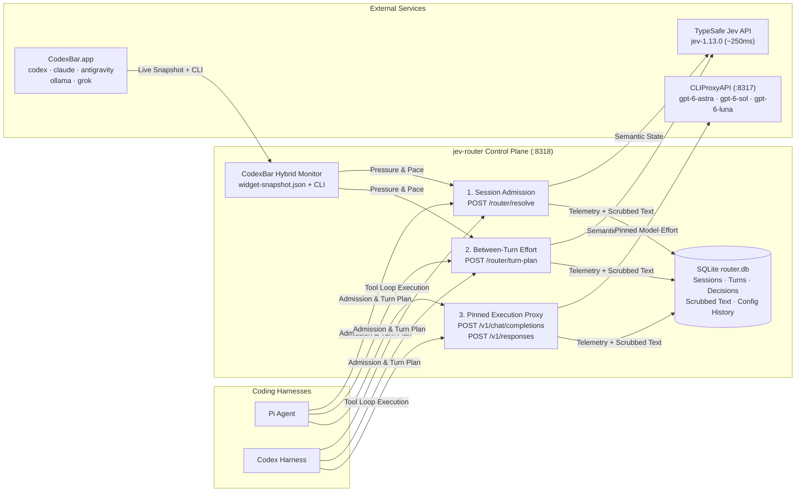
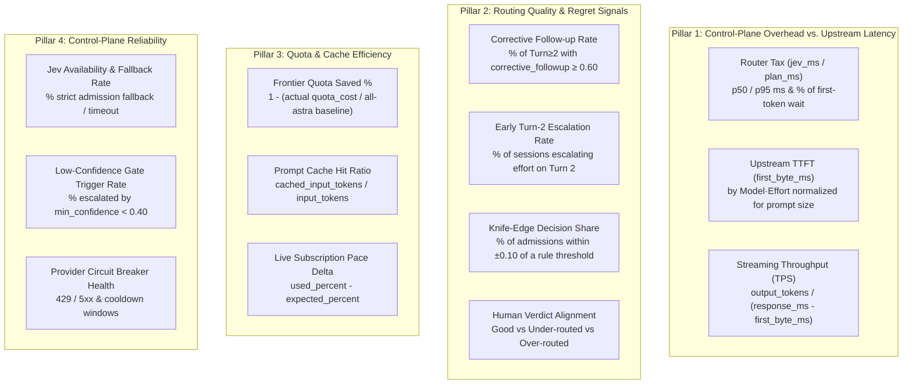
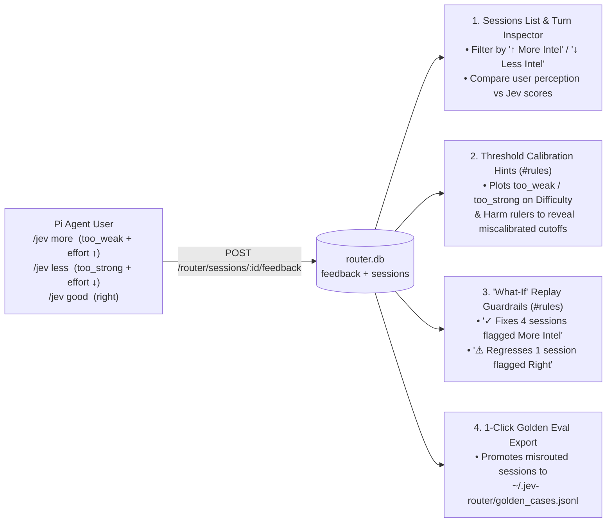

# `jev-router` Observability Platform v2 — Design Specification

**Status:** Draft Design for Next Iteration  
**Scope:** `jev-router` Core Telemetry (`features.py`, `state.py`, `pins.py`, `sessions.py`, `quota.py`, `config.py`, `app.py`) + Observability UI (`dashboard.py`, `static/dashboard.{html,css,js}`)

---

## 1. Executive Summary & System-Level Role

`jev-router` is a **local semantic control plane** that sits between coding harnesses (Pi Agent, Codex, OpenAI-compatible clients) and upstream model proxies (`CLIProxyAPI` on `:8317`). Its job is **not** to generate tokens; its job is to:

1. **Admit fresh sessions (`POST /router/resolve`)**: Inspect the user's initial prompt and hard constraints, query TypeSafe Jev (`jev-1.13.0`), evaluate the first-match rule ladder and quality lanes, check live subscription quota pressure, and bind the session to a fixed model (`gpt-6-astra`, `gpt-6-sol`, `gpt-6-luna`) and initial reasoning effort (`low`, `medium`, `high`, `xhigh`).
2. **Steer between-turn reasoning effort (`POST /router/turn-plan`)**: On each new user turn inside an admitted session, evaluate whether the user is correcting a prior mistake (`corrective_followup`), escalating complexity (`difficulty`, `p_hard`, `harm_if_wrong`), or winding down, and adjust the effort rung without breaking the provider's prompt cache.
3. **Pass through execution calls (`POST /v1/chat/completions`, `POST /v1/responses`)**: Forward tool-loop execution calls on the pinned model while recording usage, prompt cache hit rates, and first-byte vs. streaming timings.

### Why the Current (v1) Observability UI Falls Short

A review of the current observability implementation reveals five structural mismatches between what the router does and what the UI shows:

| # | Pain Point | Root Cause in Current Implementation | v2 Design Direction |
| :--- | :--- | :--- | :--- |
| **1** | **Coding plan quota is empty or stale** | [`router.yaml`](file:///Users/hy/Developer/jev-router/router.yaml#L43-L121) disables quota on all providers (`enabled: false`), [`audit_overview()`](file:///Users/hy/Developer/jev-router/src/jev_router/sessions.py#L1283-L1293) only reads historical `decisions.quota_snapshot` rows from SQLite rather than live state, and CLI `codexbar usage --source web` cannot access `CodexBar.app`'s sandboxed browser cookies (e.g., Ollama). | **Hybrid `CodexBar` integration**: Read `CodexBar.app`'s live `widget-snapshot.json` first + enrich with CLI `codexbar usage` pace metrics; expose all enabled coding subscriptions (`codex`, `claude`, `antigravity`, `ollama`, `grok`) live on `/router/audit/overview`. |
| **2** | **Sessions cannot be matched to actual coding sessions or prompts** | [`to_facts()`](file:///Users/hy/Developer/jev-router/src/jev_router/features.py#L66-L84) drops all prompt text; [`Store.log_decision()`](file:///Users/hy/Developer/jev-router/src/jev_router/pins.py#L291-L331) defaults to `log_state: false` and stores only [`state_shape`](file:///Users/hy/Developer/jev-router/src/jev_router/state.py#L49-L86) (character lengths); and [`dashboard.py`](file:///Users/hy/Developer/jev-router/src/jev_router/dashboard.py#L130-L140) strips `state` even when `log_state: true` is enabled. | **Scrubbed Session & Turn Text Persistence**: Store session `title`, full Jev `state` (`latest_user_request`, `material_the_user_pasted`, `current_user_request`, `observations`), and per-turn user prompt + assistant/tool summary (~2–4 KB cap, secret-scrubbed) in `router.db`. |
| **3** | **Session Inspector (`#s=<id>`) bars and `"Shown to Jev"` are cryptic** | Each bar in [`hero()`](file:///Users/hy/Developer/jev-router/src/jev_router/static/dashboard.js#L993-L1025) and [`outcomePane()`](file:///Users/hy/Developer/jev-router/src/jev_router/static/dashboard.js#L1889-L1916) is a raw HTTP tool-call request (10–40 per user prompt), and [`jevBody()`](file:///Users/hy/Developer/jev-router/src/jev_router/static/dashboard.js#L1342-L1366) shows `"127 chars · text not stored"` and `"names withheld"`. | **User-Turn-Centric Causal Inspector**: Group HTTP tool calls under **User Turns** (`Turn 1 (Admission)`, `Turn 2`, ...). Replace the 5 stage tabs with a unified 3-column **"Why This Route & Effort?"** causal view. |
| **4** | **No visibility into or control over routing rules & config** | Routing policy lives exclusively in [`router.yaml`](file:///Users/hy/Developer/jev-router/router.yaml) with a 6-stage pipeline that is invisible in the UI. | **New `Rules & Config` Tab (`#rules`)**: Interactive visual pipeline diagram with live traffic annotations, Visual Rule/Threshold Editor + synchronized YAML editor, historical **"What-If" replay**, and atomic **live hot-reload** saving back to `router.yaml`. |
| **5** | **Metrics focus on upstream `response_ms` rather than router performance** | [`build_overview()`](file:///Users/hy/Developer/jev-router/src/jev_router/dashboard.py#L622-L699) centers on `response_ms` (dominated by upstream generation length). It lacks router overhead vs. TTFT separation, routing regret signals, and quota/cache efficiency metrics. | **System-Level Control-Plane Metrics**: Separate **Router Tax (`jev_ms` / `plan_ms`)** from **Upstream TTFT (`first_byte_ms`)** and **Streaming TPS**; track **Routing Quality & Regret** (corrective follow-ups, Turn-2 escalations, knife-edge boundaries) and **Quota/Cache Savings**. |

### The 5 Questions Every Screen Must Answer

Every chart, table, and badge in Observability v2 must directly answer one of these five system-level questions:

1. **Identity & Context:** *"Which coding session and user turn am I looking at?"*
2. **Causal Explainability:** *"Why did `jev-router` pick this model and effort level for this turn?"*
3. **Routing Quality (Regret vs. Overkill):** *"Was that decision right, or did the user have to correct the model / wait for an over-routed frontier call?"*
4. **Control-Plane Overhead vs. Upstream Health:** *"How much latency did `jev-router` add (`jev_ms`), and how fast is the upstream model responding (`TTFT`, `TPS`)?"*
5. **Quota & Cost Efficiency:** *"How much coding subscription quota do I have left across all my plans, and how is `jev-router` steering load to protect them?"*



---

## 2. Coding Plan Quota Integration via `codexbar` (Feedback #1)

### 2.1 Diagnosis of Current Quota Limitations

1. **Disabled by default in config**: In [`router.yaml`](file:///Users/hy/Developer/jev-router/router.yaml#L43-L121), `providers.openai.quota.enabled`, `providers.ollama.quota.enabled`, and `providers.xai.quota.enabled` are all set to `false`.
2. **Dashboard never queries live `QuotaMonitor`**: [`SessionManager.audit_overview()`](file:///Users/hy/Developer/jev-router/src/jev_router/sessions.py#L1283-L1293) and [`build_overview()`](file:///Users/hy/Developer/jev-router/src/jev_router/dashboard.py#L674-L679) only look up `SELECT ts, quota_snapshot FROM decisions WHERE quota_snapshot IS NOT NULL ORDER BY id DESC LIMIT 1`. If no recent request logged a non-null `quota_snapshot`, the UI displays `"no quota snapshots"` even when `CodexBar` is running on the host.
3. **Web-cookie providers fail via standalone CLI**: `CodexBar.app` (`v0.60.3`) tracks five enabled subscriptions in `~/.codexbar/config.json`:
   - `codex` (source: `oauth`)
   - `claude` (source: `oauth`)
   - `antigravity` (source: `local`)
   - `ollama` (source: `web`)
   - `grok` (source: `web`)
   When [`CodexBarSource._poll_sync()`](file:///Users/hy/Developer/jev-router/src/jev_router/quota.py#L140-L185) runs `codexbar usage --provider ollama --source web --json-only`, the CLI fails with `"No Ollama session cookie found"` because browser session cookies live inside the macOS `CodexBar.app` container.
4. **Where `CodexBar.app` actually persists live data**: Every ~60 seconds, `CodexBar.app` writes a complete, pre-authenticated snapshot for **all enabled providers** (including `ollama` and `grok`) to:
   - `~/Library/Group Containers/Y5PE65HELJ.com.steipete.codexbar/widget-snapshot.json`

### 2.2 Hybrid `CodexBar` Architecture

We will upgrade [`src/jev_router/quota.py`](file:///Users/hy/Developer/jev-router/src/jev_router/quota.py) to use a **two-tier Hybrid `CodexBar` Collector** that tracks all enabled subscriptions in `~/.codexbar/config.json` and links them to `jev-router` providers where applicable.

```mermaid
flowchart TD
    Config["~/.codexbar/config.json\nEnabled Subscriptions:\ncodex, claude, antigravity, ollama, grok"] --> Collector["HybridCodexBarCollector (quota.py)"]
    
    WidgetSnap["~/Library/Group Containers/\nY5PE65HELJ.com.steipete.codexbar/\nwidget-snapshot.json\n(Updated every 60s by CodexBar.app)"] -->|1. Primary Fast Read (<1ms)\nIncludes Web-Cookie Providers| Collector
    
    CLIFallback["/opt/homebrew/bin/codexbar usage\n--provider <id> --json-only\n(Background refresh when snapshot >5m stale\nor for CLI-native pace fields)"] -->|2. Pace Enrichment & Fallback| Collector

    Collector --> RoutedMap["Routed Upstream Providers\n• codex -> providers.openai\n• ollama -> providers.ollama\n• grok -> providers.xai"]
    Collector --> ExternalMap["Tracked Coding Subscriptions\n(Displayed in Overview Quota Strip)\n• claude (Claude Code Max/Pro)\n• antigravity (Gemini Pro / Flash)"]
    
    RoutedMap -->|Pressure Steering & Demotion| RouterPolicy["Admission & Turn-Plan Policy"]
    RoutedMap & ExternalMap -->|Live /router/audit/overview| DashboardUI["Overview & Rules Quota Strip"]
```

#### Tier 1: Local Snapshot Reader (`widget-snapshot.json`)
- **Path discovery**: Check configured `snapshot_path`, defaulting to `~/Library/Group Containers/Y5PE65HELJ.com.steipete.codexbar/widget-snapshot.json` (and globbing `~/Library/Group Containers/*.com.steipete.codexbar/widget-snapshot.json` as fallback).
- **Schema parsed per entry in `enabledProviders[]`**:
  - `provider`: `"codex" | "claude" | "antigravity" | "ollama" | "grok"`
  - `updatedAt`: ISO-8601 timestamp (`2026-10-26T...Z`)
  - `primary`: `{ "usedPercent": float, "windowMinutes": int | null, "resetsAt": str | null, "resetDescription": str | null }` (e.g., 5-hour session window)
  - `secondary`: `{ "usedPercent": float, "windowMinutes": int | null, "resetsAt": str | null, "resetDescription": str | null }` (e.g., 7-day weekly window)
  - `tertiary`: optional 3rd window (used by `antigravity` for multiple model pools)
  - `usageRows`: `[{ "title": str, "detail": str }]` (plan name, e.g., `"Max"`, `"Pro"`, and multi-pool breakdowns for `antigravity`: `"Claude / GPT-OSS"`, `"Gemini Pro"`, `"Gemini Flash"`)
  - `tokenUsage`: `{ "sessionTokens": int, "sessionCostUSD": float, "last30DaysTokens": int, "last30DaysCostUSD": float }`
  - `creditsRemaining`: `float | null`

#### Tier 2: CLI Pace Enrichment & Stale-Snapshot Fallback
- For every window that has `windowMinutes` and `resetsAt`, [`window_expected_percent()`](file:///Users/hy/Developer/jev-router/src/jev_router/quota.py#L506-L516) in `quota.py` already computes the exact linear pace (`expected_percent`) directly from wall-clock time without spawning a subprocess:
  $$\text{expected\_percent} = \text{clamp}\left(100 \times \frac{W - (T_{\text{reset}} - T_{\text{now}})}{W},\ 0,\ 100\right)$$
- When `widget-snapshot.json` is missing or older than `stale_after_seconds` (default `300s`), `HybridCodexBarCollector` asynchronously runs `/opt/homebrew/bin/codexbar usage --provider <id> --json-only` for CLI-accessible providers (`codex`, `claude`, `antigravity`) and merges `pace.primary` / `pace.secondary` (`expectedUsedPercent`, `deltaPercent`, `stage`, `willLastToReset`).

#### Provider & Subscription Mapping

| CodexBar `provider` | `jev-router` Provider Link | Role in `jev-router` | Windows & Extra Data Available |
| :--- | :--- | :--- | :--- |
| **`codex`** | `providers.openai` (`gpt-6-astra`) | **Routed Upstream** (drives pressure & demotion) | `primary` (5h session, `300m`), `secondary` (7d weekly, `10080m`), `tokenUsage` (30d tokens & implied USD) |
| **`ollama`** | `providers.ollama` (`gpt-6-sol`, `gpt-6-luna`) | **Routed Upstream** (drives pressure & demotion) | `primary` (Session %, resetsAt), `secondary` (Weekly %, resetsAt), plan tier (`usageRows`) |
| **`grok`** | `providers.xai` (when enabled) | **Routed Upstream** | `primary` / `secondary` via `widget-snapshot.json` |
| **`claude`** | *External Subscription* (`claude`) | **Observability & Comparison** | `primary` (5h session, `300m`), `secondary` (7d weekly, `10080m`), plan (`Max`), `tokenUsage` |
| **`antigravity`** | *External Subscription* (`antigravity`) | **Observability & Comparison** | `primary` (Claude/GPT-OSS pool), `secondary` (Gemini Pro pool), `tertiary` (Gemini Flash pool), `usageRows` |

### 2.3 Configuration Changes in `router.yaml`

Replace the per-provider disabled boilerplate in [`router.yaml`](file:///Users/hy/Developer/jev-router/router.yaml#L43-L121) with a top-level `codexbar` integration block plus enabled provider links:

```yaml
codexbar:
  enabled: true
  snapshot_path: ~/Library/Group Containers/Y5PE65HELJ.com.steipete.codexbar/widget-snapshot.json
  config_path: ~/.codexbar/config.json
  cli_binary: /opt/homebrew/bin/codexbar
  poll_interval_seconds: 60
  cli_fallback_after_seconds: 300
  include_external_subscriptions: true   # surface claude, antigravity alongside routed providers

providers:
  openai:
    type: openai_compatible
    base_url: http://127.0.0.1:8317/v1
    quota:
      enabled: true
      source: codexbar
      codexbar_provider: codex
      poll_interval_seconds: 60
      stale_after_seconds: 900
  ollama:
    type: openai_compatible
    base_url: http://127.0.0.1:8317/v1
    quota:
      enabled: true
      source: codexbar
      codexbar_provider: ollama
      poll_interval_seconds: 60
      stale_after_seconds: 900
```

### 2.4 Dashboard Quota UI Redesign

In [`dashboard.py`](file:///Users/hy/Developer/jev-router/src/jev_router/dashboard.py#L674-L679), `build_overview()` will receive live snapshots directly from `QuotaMonitor.all_snapshots()` (injected via [`app.py`](file:///Users/hy/Developer/jev-router/src/jev_router/app.py)), falling back to the latest SQLite `decisions.quota_snapshot` only in offline replay mode.

On the **Overview** tab (`#overview`), the **Coding Subscriptions & Quota Strip** displays two groups:

1. **Routed Coding Subscriptions (`codex` -> OpenAI `gpt-6-astra`, `ollama` -> Ollama `gpt-6-sol` / `gpt-6-luna`)**:
   - **Dual-Window Bar with Pace Tick**:
     - Horizontal progress bar (`0%` to `100%`) showing `used_percent` for **5h Session** (`primary`) and **7d Weekly** (`secondary`).
     - A vertical tick mark on the bar at `expected_percent` (linear time elapsed in the window).
     - Color coding: **Calm** (`pressure < 0.35`, green), **Elevated / Ahead of Pace** (`0.35 <= pressure < 0.60`, amber, e.g., `43% used vs 25% expected (+18%)`), **Demoting** (`0.60 <= pressure < 0.85`, orange — triggers fallback promotion in [`apply_quota()`](file:///Users/hy/Developer/jev-router/src/jev_router/quota.py#L761-L824)), **Exhausted** (`pressure >= 0.85`, red).
   - **Router Impact Badge**: Explicitly tells the user what `jev-router` is doing with this quota right now:
     - e.g., `"Active: Normal routing (pressure 0.31 < 0.60 demote threshold)"` or `"Steered: Demoting gpt-6-astra (cost 1.0) → gpt-6-sol where equivalent"`.
2. **External Coding Subscriptions (`claude`, `antigravity`)**:
   - Displayed in a compact companion row (`Tracked via CodexBar · Not routed by jev-router`) showing 5h / 7d bars, pace delta, and Antigravity multi-pool rows (`Claude/GPT-OSS`, `Gemini Pro`, `Gemini Flash`) plus 30-day token/cost rollups from `CodexBar`.

---

## 3. Session & Turn Text Capture Architecture (Feedback #2)

### 3.1 Why Text Is Currently Missing

1. **Admission (`POST /router/resolve`)**:
   - [`extract_features()`](file:///Users/hy/Developer/jev-router/src/jev_router/features.py#L140-L246) extracts `first_user_message`, `last_user_message`, `system_prompt`, and `messages`.
   - [`build_state()`](file:///Users/hy/Developer/jev-router/src/jev_router/state.py#L179-L263) builds the Jev state (`latest_user_request`, `material_the_user_pasted`, `earlier_request_in_this_conversation`).
   - Then [`features.to_facts()`](file:///Users/hy/Developer/jev-router/src/jev_router/features.py#L66-L84) discards all text strings, [`Store.log_decision()`](file:///Users/hy/Developer/jev-router/src/jev_router/pins.py#L291-L331) drops `state` because `settings.log_state` is `false` in [`router.yaml`](file:///Users/hy/Developer/jev-router/router.yaml#L21), and [`dashboard.py`](file:///Users/hy/Developer/jev-router/src/jev_router/dashboard.py#L130-L140) strips `state`, `tool_names`, and `languages` before returning JSON to the browser.
2. **Between-Turn Planning (`POST /router/turn-plan`)**:
   - [`SessionManager.plan_turn()`](file:///Users/hy/Developer/jev-router/src/jev_router/sessions.py#L618-L905) constructs `state = build_turn_state(session.ledger, body)` containing `task_request`, `current_user_request`, `user_constraints`, `quoted_material`, and `observations`, sends it to Jev, and then **discards `state` completely** — `decisions` rows logged for `turn-plan` set `state_shape=None` and `state=None`.
3. **Execution Calls (`POST /v1/chat/completions`, `POST /v1/responses`)**:
   - In [`app.py`](file:///Users/hy/Developer/jev-router/src/jev_router/app.py#L1185-L1295), the proxy streams SSE chunks back to the client and parses token usage (`input_tokens`, `output_tokens`, `cached_input_tokens`), but never extracts a summary of the assistant's response or the tool calls made during that turn.

### 3.2 Privacy & Secret-Scrubbing Pipeline (`src/jev_router/scrub.py`)

Before any text is written to `~/.jev-router/router.db`, it passes through a deterministic, zero-dependency scrubber (`src/jev_router/scrub.py`):

1. **Credential & Token Redaction**:
   - API keys & bearer tokens: `sk-[A-Za-z0-9_-]{20,}`, `rk-[A-Za-z0-9_-]{20,}`, `gh[pousr]_[A-Za-z0-9]{20,}`, `github_pat_[A-Za-z0-9_]{20,}`, `xox[baprs]-[A-Za-z0-9-]+`, `AIza[0-9A-Za-z_-]{35}`, `eyJ[A-Za-z0-9_-]{10,}\.[A-Za-z0-9_-]{10,}\.[A-Za-z0-9_-]{10,}` (JWTs) $\rightarrow$ `[REDACTED_SECRET]`.
   - PEM private keys (`-----BEGIN ... PRIVATE KEY-----`) $\rightarrow$ `[REDACTED_PRIVATE_KEY]`.
   - Inline `.env` / header assignments matching `(API_KEY|SECRET|TOKEN|PASSWORD|AUTHORIZATION)\s*[:=]\s*['"]?[^\s'"]+` $\rightarrow$ `\1=[REDACTED]`.
2. **Binary & Data-URI Stripping**:
   - Base64 image data URIs (`data:image/[^;]+;base64,[A-Za-z0-9+/=]+`) $\rightarrow$ `[IMAGE_DATA_URI]`.
   - Hex/base64 single-token blobs $> 256$ chars $\rightarrow$ `[BINARY_BLOB_OMITTED]`.
3. **Head + Tail Squeeze Truncation (`squeeze(text, cap)`)**:
   - Reuses [`squeeze()`](file:///Users/hy/Developer/jev-router/src/jev_router/state.py#L121-L132) from `state.py` (which keeps the first 70% and last 30% with `"\n...\n"` in between) so both the opening instruction and trailing question/error trace are preserved within a strict byte budget.

### 3.3 What Text We Capture & Size Budgets

| Artefact | Where Captured | Field / Budget | Purpose in UI |
| :--- | :--- | :--- | :--- |
| **Session Title (`title`)** | First user turn at `/router/resolve` (or first `/v1/*` call) | `120 chars` (single line, stripped of markdown headers/code fences) | Displayed as the primary human-readable title in the Sessions list and Session header so you immediately recognize the Pi Agent or Codex task. |
| **Session Opening Preview (`prompt_preview`)** | First user turn (`latest_user_request`) | `400 chars` | Shown as a 2-line subtitle under the session row in `#sessions` and searchable via full-text search. |
| **Workspace / Harness Hint (`workspace_hint`)** | Extracted from system prompt / harness environment block (e.g., `cwd`, repo basename like `jev-router`) if present | `120 chars` | Badge on session row (e.g., `repo: jev-router`) to group coding sessions by project. |
| **Full Jev Input State (`state`)** | Every `/router/resolve` and `/router/turn-plan` decision | JSON object (~2–4 KB total, already squeezed by [`continuation_aware_v1()`](file:///Users/hy/Developer/jev-router/src/jev_router/state.py#L179-L263) and [`build_turn_state()`](file:///Users/hy/Developer/jev-router/src/jev_router/sessions.py#L228-L327)) | Replaces `"127 chars · text not stored"` in the Session Inspector with the exact `latest_user_request`, `material_the_user_pasted`, `earlier_request_in_this_conversation`, `current_user_request`, and provenanced `observations` that Jev evaluated. |
| **Per-Turn User Prompt (`user_prompt`)** | Admission turn + each new user turn | `2,048 chars` (squeezed) | Displayed at the top of each User Turn card in the Session Inspector. |
| **Per-Turn Assistant & Tool Summary (`turn_summary_json`)** | Updated as `/v1/chat/completions` or `/v1/responses` calls complete within a turn | `2,048 chars` JSON: `{ "tool_calls": [{"name": "bash", "count": 3, "last_status": "ok"}], "assistant_snippet": "...", "files_touched": [...] }` | Shows what happened during the turn's tool loop (and why the next user turn might have been a corrective follow-up). |

### 3.4 SQLite Schema Migrations (`~/.jev-router/router.db`)

All migrations follow `jev-router`'s additive migration pattern (`ALTER TABLE ... ADD COLUMN` in [`Store._migrate()`](file:///Users/hy/Developer/jev-router/src/jev_router/pins.py#L180-L246) and [`SessionManager._init_db()`](file:///Users/hy/Developer/jev-router/src/jev_router/sessions.py#L365-L450)):

```sql
-- 1. Enrich `sessions` table (src/jev_router/sessions.py)
ALTER TABLE sessions ADD COLUMN title TEXT;
ALTER TABLE sessions ADD COLUMN prompt_preview TEXT;
ALTER TABLE sessions ADD COLUMN workspace_hint TEXT;
ALTER TABLE sessions ADD COLUMN turn_count INTEGER NOT NULL DEFAULT 1;
ALTER TABLE sessions ADD COLUMN escalation_count INTEGER NOT NULL DEFAULT 0;
ALTER TABLE sessions ADD COLUMN corrective_count INTEGER NOT NULL DEFAULT 0;

-- 2. Enrich `decisions` table (src/jev_router/pins.py)
ALTER TABLE decisions ADD COLUMN turn_index INTEGER;
ALTER TABLE decisions ADD COLUMN user_prompt TEXT;
ALTER TABLE decisions ADD COLUMN assistant_summary TEXT;
ALTER TABLE decisions ADD COLUMN tool_calls_json TEXT;
```

And in [`router.yaml`](file:///Users/hy/Developer/jev-router/router.yaml#L21):
- Change `settings.log_state: true` to be the **shipped default**, with `settings.scrub_secrets: true` and `settings.turn_text_max_chars: 2048`.
- Update [`dashboard.py`](file:///Users/hy/Developer/jev-router/src/jev_router/dashboard.py#L130-L140) so `project_decision()` and `build_session_detail()` preserve `state`, `user_prompt`, `assistant_summary`, `tool_calls_json`, `features.tool_names`, and `features.languages`.

---

## 4. Session Inspector Page (`#s=<id>`) Redesign (Feedback #3)

### 4.1 Why the Current Session Page Is Confusing

1. **The Mysterious Vertical Bars**:
   - In [`hero()`](file:///Users/hy/Developer/jev-router/src/jev_router/static/dashboard.js#L993-L1025), the strip of bars (`button.tick`) plots **every raw HTTP execution call** (`POST /v1/chat/completions` or `/v1/responses`), with bar height proportional to `input_tokens`.
   - In [`outcomePane()`](file:///Users/hy/Developer/jev-router/src/jev_router/static/dashboard.js#L1889-L1916), a second strip of bars (`button.cb`) again plots every raw HTTP call, with bar height proportional to `response_ms` and a bottom segment for `first_byte_ms`.
   - **Why this fails for coding agents**: When you type a single prompt in Pi Agent or Codex, the agent runs an autonomous tool loop of 10–40 HTTP calls (`read_file`, `bash`, `edit_file`, etc.). Because `jev-router` pins the model for the session and only makes routing/effort decisions at **User Turn Boundaries** (`Turn 1` admission, `Turn 2` user follow-up, etc.), showing 35 unlabelled HTTP bars hides the actual conversation structure and makes you wonder *"Is each bar a turn? A message? Why didn't Jev run on bar #14?"*
2. **The Cryptic `"Shown to Jev"` Card & 5 Stage Tabs**:
   - Currently, clicking a decision opens 5 separate tabs (`Request` $\to$ `Jev` $\to$ `Policy` $\to$ `Route` $\to$ `Outcome`).
   - Under `Jev` $\to$ `"Shown to Jev"`, [`jevBody()`](file:///Users/hy/Developer/jev-router/src/jev_router/static/dashboard.js#L1342-L1366) renders `state_shape` character counts (`latest_user_request: 127 chars · text not stored`) and `tool names: 6 · names withheld`.
   - To answer *"Why did this request get routed to `gpt-6-sol · high`?"*, you have to click back and forth across 4 tabs and mentally join Jev's numeric scores (`difficulty: 1.42`) against thresholds hidden in `router.yaml`.

### 4.2 Redesign Core Principle

> **Rule for the Session Page:** Every visual element on `#s=<id>` must either (a) identify the coding session and user turn, or (b) directly explain **why** that turn was routed to its model and effort level, and **how** that choice performed. Everything else is removed.

### 4.3 Replacing the Bars: The User-Turn Timeline

Instead of raw HTTP request bars, the top of the session page features a **User-Turn Timeline Strip** where **1 Card = 1 User Turn**:

```
┌──────────────────────────────────────────────────────────────────────────────────────────────────────────┐
│ ← Sessions   Fix quota snapshot race in QuotaMonitor                              pi-session · jev-router│
│              Pinned Model: gpt-6-sol (Ollama) · 4 User Turns · 19 HTTP Tool Calls · 1 Effort Escalation  │
├──────────────────────────────────────────────────────────────────────────────────────────────────────────┤
│ USER TURN TIMELINE (Click a turn to inspect why it routed that way)                                      │
│                                                                                                          │
│ ┌─────────────────────────┐  ┌─────────────────────────┐  ┌─────────────────────────┐  ┌───────────────┐ │
│ │ TURN 1 · Admission      │  │ TURN 2 · Follow-up      │  │ TURN 3 · Follow-up  ▲   │  │ TURN 4        │ │
│ │ "I recently rebuilt..." │  │ "Now run pytest on..."  │  │ "No, test_quota still.."│  │ "Looks good,  │ │
│ │                         │  │                         │  │ [Corrective Follow-up]  │  │  clean up..." │ │
│ │ Route: sol_high         │  │ Effort: high (held)     │  │ Effort: high → xhigh ▲  │  │ Effort: high ▼│ │
│ │ Rule:  hard (diff 1.54) │  │ diff 1.12 · harm 0.28   │  │ corrective 0.74 ≥ 0.60  │  │ 2x calm turns │ │
│ │ 6 HTTP calls · 42k tok  │  │ 4 HTTP calls · 58k tok  │  │ 7 HTTP calls · 89k tok  │  │ 2 HTTP calls  │ │
│ └─────────────────────────┘  └─────────────────────────┘  └─────────────────────────┘  └───────────────┘ │
└──────────────────────────────────────────────────────────────────────────────────────────────────────────┘
```

- **How HTTP execution calls are grouped into User Turns**:
  - **Turn 1 (Session Admission)**: Starts at the `/router/resolve` decision (or first `/v1/*` decision) and aggregates all subsequent `/v1/chat/completions` and `/v1/responses` calls until the next user prompt arrives.
  - **Turn $N$ ($N \ge 2$)**: Starts when either (a) a `/router/turn-plan` decision with `trigger: "new_user_turn"` is logged, or (b) an execution request arrives whose `features.user_turns` count incremented relative to the prior request.
  - Inside a selected User Turn, the aggregated HTTP tool calls (`6 HTTP calls · 42k tok · 91% cache hit`) are shown as a compact collapsible sub-table at the bottom of the turn, never as the primary navigation axis.

### 4.4 Replacing `"Shown to Jev"` & the 5 Stage Tabs: The 3-Column Causal Inspector

When you select any **User Turn** in the timeline, the page displays a single unified **3-Column Causal View** (`1. What the User Asked & Jev Saw` $\rightarrow$ `2. How Jev Scored It` $\rightarrow$ `3. Why Policy Picked Model & Effort`):

```mermaid
flowchart LR
    subgraph Col1["Column 1: What Jev Saw (Input)"]
        Prompt["Actual User Prompt Text\n(latest_user_request)"]
        Pasted["Pasted Code / Logs\n(material_the_user_pasted)"]
        Context["Prior Context & Observations\n(earlier_request / harness observations)"]
        Constraints["Hard Eligibility Gates\n• Tools: 6 (bash, read, edit...)\n• Vision: No\n• Context Budget: 14.2k / 200k"]
    end

    subgraph Col2["Column 2: How Jev Scored It (240ms)"]
        TaskDist["Task Classification\ncoding: 94% · debugging: 4%\n(Gate: 0.94 ≥ 0.40 Pass)"]
        DiffBar["Difficulty Score: 1.54 / 3.0\n[0: Lookup 2%] [1: Standard 46%]\n[2: Multi-step 48%] [3: Hard 4%]\np_hard (L2+L3) = 52%"]
        HarmBar["Harm if Wrong: 0.41 / 1.0\n[0: Easy to spot 59%]\n[1: Costly / subtle 41%]"]
        ShadowSignals["Turn Signals (Turn ≥ 2)\ncorrective_followup: 0.12\nfailure_mode: none (88%)"]
    end

    subgraph Col3["Column 3: Why Policy Picked Route & Effort"]
        Ladder["Rule Ladder Walkthrough\n✗ images_easy (has_images=false)\n✗ very_hard (diff 1.54 < 2.25)\n✓ MATCH #4: hard\n  Because: difficulty 1.54 ≥ 1.45\n  Route: coding_strong → sol_high"]
        QuotaCheck["Quota & Quality Lane Check\n• Lane: coding_strong\n• Primary: gpt-6-astra·medium (pressure 0.68 > 0.60)\n• Steered to equivalent fallback:\n  gpt-6-sol·high (pressure 0.18)"]
        Outcome["Turn Outcome & Feedback\n• Router Tax: 240ms Jev\n• Upstream TTFT: 610ms · 54 tok/s\n• Tools run: bash(2), edit(1)\n[👍 Good] [👎 Too Weak] [👎 Overkill]"]
    end

    Col1 --> Col2 --> Col3
```



#### Column 1: What the User Asked & What Was Shown to Jev
- **Actual Text Cards (No more `"text not stored"`)**:
  - **`latest_user_request`** (or **`current_user_request`** on Turn $\ge 2$): Renders the actual user instruction in a readable monospace/markdown card.
  - **`material_the_user_pasted`** (or **`quoted_material`**): Collapsible block showing the exact stack trace, diff, or file snippet that [`split_pasted()`](file:///Users/hy/Developer/jev-router/src/jev_router/state.py#L135-L176) separated from the user's instruction, with an explanation badge: *"Separated as quoted material so pasted code/logs cannot trick Jev into misclassifying the prompt."*
  - **`earlier_request_in_this_conversation`** / **`observations`**: On follow-up turns, shows the initial task anchor and provenanced observations (`harness: command exited 1`, `assistant_claim: updated quota.py`).
- **Hard Eligibility Checklist**:
  - Compact pill strip showing why candidate models passed or failed code-level gates before Jev even ran:
    - `Tools required: Yes (bash, read, write, edit)` $\rightarrow$ all 3 models eligible.
    - `Images attached: No`.
    - `Token budget: 14,210 est. input + 16,384 reserve = 30,594 tokens` $\rightarrow$ fits `gpt-6-luna` (128k), `gpt-6-sol` (200k), `gpt-6-astra` (400k).

#### Column 2: How Jev Evaluated It (With Rubric Translations & Threshold Rulers)
Instead of raw numbers like `difficulty: 1.54`, Column 2 renders **visual threshold rulers** tied directly to the active policy thresholds in `router.yaml`:
- **Task (`task_v2`)**: Shows top task (`coding · 94%`) + confidence gate status (`0.94 ≥ 0.40 min_confidence`).
- **Difficulty (`difficulty_v2`, scale `0.0 – 3.0`)**:
  - Horizontal ruler from `0.0` to `3.0` with vertical markers at every rule threshold:
    - `0.75` (`easy` ceiling)
    - `1.45` (`moderate` $\rightarrow$ `hard` boundary)
    - `2.25` (`hard` $\rightarrow$ `very_hard` boundary)
  - Plots the current turn's score (`1.54`) right on the ruler so you immediately see *how close* it was to `moderate` (`1.45`, delta `+0.09`) vs. `very_hard` (`2.25`).
  - Displays the 4 rubric level probabilities (`L0 Lookup`, `L1 Standard`, `L2 Multi-step`, `L3 Genuinely hard`) with human-readable tooltips from `router.yaml` and the derived `p_hard = P(L2) + P(L3)` score.
- **Harm if Wrong (`harm_v1`, scale `0.0 – 1.0`)**:
  - Horizontal ruler from `0.0` to `1.0` with markers at `0.35` (`moderate_careful`), `0.50` (`easy` ceiling), and `0.65` (`high_harm`).
- **Turn-Plan Signals (for Turn $\ge 2$)**:
  - **`corrective_followup`** ruler (`0.0 – 1.0`, escalation threshold at `0.60`).
  - **Shadow `failure_mode`** breakdown (`none`, `misunderstood_intent`, `wrong_patch_or_answer`, `tool_or_Verification_loop`, `incomplete_execution`).

#### Column 3: Why Policy Picked This Model & Effort
- **For Turn 1 (Admission) — The Rule Waterfall**:
  - Shows the ordered rule ladder from `router.yaml`. Rules that failed are collapsed into compact dim rows stating the exact clause that failed (e.g., `✗ very_hard — difficulty 1.54 < 2.25`); the **winning rule** is highlighted in full with every matched condition checked in green (`✓ hard — difficulty 1.54 ≥ 1.45`).
  - **Quota & Counterfactual Callout**:
    - If quota pressure left the route untouched: `"Quota Calm: Kept primary candidate gpt-6-sol · high (Ollama pressure 0.18 < 0.60)"`.
    - If quota pressure steered the route: `"Quota Steered: Rule 'hard' preferred gpt-6-astra · medium, but OpenAI pressure is 0.68 (> 0.60). Promoted equivalent fallback gpt-6-sol · high in lane 'coding_strong'."`
- **For Turn $\ge 2$ (Between-Turn Adaptive Effort) — The Effort State Machine**:
  - Shows `prior_effort` $\rightarrow$ `next_effort` (`reason_code`, e.g., `escalate_corrective`, `hold_steady`, `downgrade_confirmed`) and the current `low_risk_streak` counter (`1 / 2 confirmations needed to step down`).
- **Turn Execution Summary & 1-Click Verdict**:
  - Shows the assistant's final response snippet and tool calls executed in that turn (`bash × 3`, `edit × 1`), timing split (`Router: 240ms` | `Upstream TTFT: 610ms` | `Streaming: 54 tok/s`), and inline feedback buttons (`Good Route`, `Under-routed / Too Weak`, `Over-routed / Overkill`).

---

## 5. New "Rules & Config" Tab (`#rules`) & Live Hot-Reload (Feedback #4)

### 5.1 Goals of the `Rules & Config` Tab

Add a third top-level navigation tab alongside `Overview` and `Sessions`:
- `Overview` (`#overview`) | `Sessions` (`#sessions`) | **`Rules & Config` (`#rules`)**

This tab serves two tightly coupled purposes:
1. **Visual Architecture & Policy Map**: Illustrate `jev-router`'s 6-stage routing pipeline with live traffic annotations so the user can see *how* requests flow through gates, rules, quality lanes, quota steering, and between-turn effort rules.
2. **Interactive Policy Editor + "What-If" Replay + Live Hot-Reload**: Let the user tune thresholds, rule ordering, route candidates, quota weights, and adaptive effort settings via either a structured **Visual Editor** or a synchronized **YAML Editor**, preview the exact impact on recent sessions, and atomically save + hot-reload [`router.yaml`](file:///Users/hy/Developer/jev-router/router.yaml).

### 5.2 Visual Architecture Diagram (Interactive SVG/Flow Canvas)

At the top of `#rules`, an interactive 6-stage pipeline diagram visualizes the active configuration and overlays **empirical traffic shares** from the selected time window (`24h` / `7d` / `all`):

```mermaid
flowchart LR
    subgraph S1["Stage 1: State Builder"]
        SB1["continuation_aware_v1\n• Request cap: 3,000 chars\n• Paste split: ≥400c & ≥50%\n• Tail pullback: ≤400c"]
    end

    subgraph S2["Stage 2: Hard Gates"]
        HG1["Eligibility Filter\n• Tools support\n• Vision support\n• Context window ≥ est + reserve"]
    end

    subgraph S3["Stage 3: Jev & Confidence Gate"]
        JG1["TypeSafe jev-1.13.0\n• task_v2\n• difficulty_v2\n• harm_v1"]
        JG2{"Confidence ≥ 0.40?\n(skip difficulty if\nL3 mass < 0.10)"}
        JGFallback["Admission Fallback\nfrontier_medium"]
        JG1 --> JG2
        JG2 -->|Low Conf (1.8%)| JGFallback
    end

    subgraph S4["Stage 4: First-Match Rule Ladder"]
        R1["1. images_easy (0%)"]
        R2["2. images_need_vision (2.1%)"]
        R3["3. very_hard: diff ≥ 2.25 (6.4%)"]
        R4["4. hard: diff ≥ 1.45 (28.5%)"]
        R5["5. high_harm: harm ≥ 0.65 (4.2%)"]
        R6["6. moderate_careful (11.0%)"]
        R7["7. moderate_tools (19.3%)"]
        R8["8. moderate (8.1%)"]
        R9["9. easy: diff ≤ 0.75 (18.6%)"]
        RDef["10. default: sol_high (1.8%)"]
    end

    subgraph S5["Stage 5: Quota & Quality Lanes"]
        Q1["Pressure = max(5h, 7d) × cost\n• Demote if > 0.60\n• Exhausted if ≥ 0.85\n• Guard: must stay in Quality Lane"]
    end

    subgraph S6["Stage 6: Between-Turn Effort"]
        AE1["Adaptive Effort (turn_state_v1)\n▲ Upgrade: diff≥1.8 | harm≥0.6 | corr≥0.6\n▼ Downgrade: 2× turns (diff≤0.8, harm≤0.2)"]
    end

    S1 --> S2 --> S3
    JG2 -->|Pass (98.2%)| S4
    S4 --> S5 --> S6
```

- **Interactive Nodes**:
  - Each rule node in **Stage 4** displays its condition formula, target route (`coding_careful`, `sol_high`, `luna_fast`, etc.), and **live hit rate badge** (e.g., `28.5% · 41 sessions`).
  - Clicking any stage node scrolls the editor pane below directly to that stage's controls, or filters `#sessions` to sessions that matched that rule.

### 5.3 Dual-Mode Editor + "What-If" Replay + Hot-Reload Workflow

Below the pipeline diagram, the `Rules & Config` workspace is split into left and right panes:

#### Left Pane: Synchronized Visual Editor & Raw YAML Editor
Users can toggle between (or view side-by-side):
1. **Visual Policy Editor**:
   - **Rule Ladder Cards (Drag-to-Reorder)**:
     - Edit `when` clauses using sliders/number inputs for `difficulty` (`min`/`max`), `harm_if_wrong` (`min`/`max`), `p_hard`, `has_images`, `has_tools`, `task` multi-select, and `route` dropdown.
   - **Routes & Quality Lanes Matrix**:
     - Edit ordered `candidates` (`model`, `effort`, `equivalent: true/false`) and see which `(model, effort)` pairs are qualified in each `quality_lane` (`easy_general`, `coding_moderate`, `coding_strong`, `coding_careful`, `frontier_rescue`).
   - **Quota Steering & Model Costs**:
     - Sliders for `demote_above` (`0.60`), `exhausted_above` (`0.85`), `downgrade_effort_at` (`0.60`), and per-model `quota_cost` (`gpt-6-astra: 1.0`, `gpt-6-sol: 0.2`, `gpt-6-luna: 0.01`).
   - **Between-Turn Adaptive Effort**:
     - Toggle `session_routing.adaptive_effort_enabled` (`true`/`false`), adjust `upgrade_difficulty` (`1.8`), `upgrade_harm` (`0.6`), `upgrade_p_hard` (`0.4`), `corrective_followup` (`0.6`), and `downgrade_confirmations` (`2`).
2. **YAML Editor**:
   - Full [`router.yaml`](file:///Users/hy/Developer/jev-router/router.yaml) text editor with line numbers, structural validation errors, and an inline unified diff viewer (`Diff vs. Saved router.yaml`).

#### Right Pane: "What-If" Historical Replay Simulator
Before saving changes to disk, clicking **"Preview Impact (Replay)"** sends the draft configuration to `POST /router/audit/config/preview`.
- The backend re-runs [`evaluate_policy()`](file:///Users/hy/Developer/jev-router/src/jev_router/app.py#L465-L615) and [`apply_quota()`](file:///Users/hy/Developer/jev-router/src/jev_router/quota.py#L761-L824) in memory against the last $N$ (e.g., 200) stored admission and turn-plan decisions in `router.db` using their stored Jev scores, features, and quota snapshots (**zero Jev API calls required**, completes in `< 15 ms`).
- Displays a **Replay Impact Report**:
  - **Migration Summary**: e.g., `"14 of 128 sessions (10.9%) would change route"`.
  - **Tier Shift Bar**: Shows before vs. after share of `gpt-6-astra` (Frontier), `gpt-6-sol` (Workhorse), and `gpt-6-luna` (Fast), plus estimated **Frontier Quota Saved %** delta.
  - **Changed Sessions Diff Table**: Lists every session whose route or effort would change:
    - `Session Title` | `Diff / Harm Scores` | `Old Rule → Old Route` | `New Rule → New Route` | `Human Feedback (if any)`.
    - Highlights if a config change fixes previously flagged `Under-routed` or `Over-routed` sessions!

#### Atomic Save & Live Hot-Reload (`POST /router/audit/config/apply`)
When the user clicks **"Save & Hot-Reload"**:
1. **Validation**: Parses the candidate config through [`parse_config()`](file:///Users/hy/Developer/jev-router/src/jev_router/config.py#L480-L790), verifying all rule references, route candidates, quality lane qualification checks, and question schemas. If invalid, returns HTTP `422` with exact line/field errors.
2. **Backup & Atomic Write**:
   - Copies current `router.yaml` to `~/.jev-router/config-backups/router.<timestamp>.yaml`.
   - Writes the new YAML to `router.yaml.tmp` and atomically replaces `router.yaml` via `os.replace()`.
3. **In-Memory Hot-Reload**:
   - Atomically swaps `app.state.config` (and updates `SessionManager.config` and `QuotaMonitor` settings) without dropping active HTTP streams or restarting the uvicorn process.
   - Computes the new `config_hash` (`sha256[:12]`) so subsequent decisions in `router.db` are tagged with the new `config_hash`, enabling before/after cohort comparison in the Overview tab.

---

## 6. System-Level Observability Metrics Redesign (Feedback #5)

### 6.1 Critique of Current Metrics

Currently, [`build_overview()`](file:///Users/hy/Developer/jev-router/src/jev_router/dashboard.py#L622-L699) and [`dashboard.js`](file:///Users/hy/Developer/jev-router/src/jev_router/static/dashboard.js#L516-L780) emphasize **`response_ms`** (total end-to-end HTTP completion time) across models, sessions, and charts.

Why `response_ms` is misleading for a router observability tool:
1. **Confounded by output length**: A 2,500-token code generation response takes 35 seconds; a 20-token bash command takes 0.8 seconds. Plotting `response_ms` measures *how much text the model wrote*, not router overhead or upstream responsiveness.
2. **Blurs Control Plane vs. Data Plane**: If a turn feels slow, `response_ms` cannot tell you whether TypeSafe Jev spiked (`jev_ms`), whether `CLIProxyAPI`/upstream queued the prompt before emitting the first token (`first_byte_ms` / TTFT), or whether token streaming was slow (`TPS`).
3. **Zero visibility into Routing Quality (Regret)**: A router that routes 100% of requests to `gpt-6-luna · low` in `200ms` has great latency and terrible routing quality if the user has to argue with the model on Turn 2.

### 6.2 The v2 System-Level Metric Taxonomy

We reorganize all metrics across `Overview` and `Sessions` into **Four System Pillars**:



#### Pillar 1: Latency Decomposition (Router Tax vs. Upstream TTFT vs. Streaming TPS)
Instead of `response_ms`, every latency visualization separates three orthogonal timings:
1. **Router Control-Plane Overhead ("Router Tax")**:
   - **Admission Jev Latency (`jev_ms`)**: p50 / p95 milliseconds spent calling TypeSafe Jev during `POST /router/resolve` (target: `< 300 ms`).
   - **Between-Turn Plan Latency (`plan_ms`)**: p50 / p95 milliseconds spent in `POST /router/turn-plan`.
   - **Execution Proxy Overhead (`~0 ms`)**: Because execution calls hit a pinned session, `jev-router` adds `0 ms` of Jev latency on tool-loop calls (`100%` of tool calls bypass Jev).
   - **Amortized Router Tax per Request**: $\frac{\sum \text{jev\_ms} + \sum \text{plan\_ms}}{\text{Total HTTP Requests in Session}}$ (typically `< 15 ms` per request across a 20-call coding session).
2. **Upstream Time to First Token (`TTFT` = `first_byte_ms`)**:
   - Measured on `/v1/chat/completions` and `/v1/responses` streams from the moment `jev-router` forwards the request to `CLIProxyAPI` until the first SSE content/reasoning chunk arrives.
   - Broken down by `(model, effort)` (`gpt-6-astra · high`, `gpt-6-sol · high`, `gpt-6-luna · low`) because higher reasoning effort (`xhigh`, `high`) directly increases pre-token thinking time before the first byte is emitted.
3. **Upstream Streaming Speed (`TPS`, Tokens/sec)**:
   - $\text{TPS} = \frac{\text{output\_tokens}}{\max(\text{response\_ms} - \text{first\_byte\_ms},\ 1) / 1000}$.
   - Isolates upstream generation speed from prompt length and reasoning prefill.

#### Pillar 2: Routing Quality & Regret Signals (Zero-Label + Human-in-the-Loop)
How do we know if `jev-router` routed a session to a model/effort that was **too weak** (under-routing regret) or **unnecessarily heavy** (over-routing waste)?
1. **Corrective Follow-up Rate (Implicit Under-Routing Signal)**:
   - Already scored by Jev on every `/router/turn-plan` call via the `corrective_followup` question (`"Is the user correcting, rejecting, or pushing back on the assistant's previous work?"`).
   - **Metric**: Percentage of follow-up turns (`Turn ≥ 2`) where `corrective_followup >= 0.60`, grouped by the initial admission route (`luna_fast`, `sol_medium`, `sol_high`, `astra_medium`).
   - **Why it matters**: If `luna_fast` or `sol_medium` shows a `35%` corrective follow-up rate on `coding` tasks while `sol_high` shows `8%`, the threshold for `moderate` $\rightarrow$ `hard` is set too high.
2. **Early Turn-2 Escalation Rate**:
   - Percentage of sessions where `Turn 2` immediately triggers an upward effort escalation (`escalate_difficulty`, `escalate_harm`, `escalate_p_hard`, or `escalate_corrective`). High Turn-2 escalation on a specific admission rule means Turn 1 under-estimated the task.
3. **Session Abandonment / Rapid Re-ask Rate ("Bounce Rate")**:
   - Sessions with `<= 2` requests that terminate within `60s` followed by a new session from the same client within `90s` with high token overlap in `title`/`prompt_preview`.
4. **Knife-Edge Boundary Share**:
   - Percentage of admissions where `difficulty` or `harm_if_wrong` fell within `±0.10` of the winning or adjacent rule threshold (e.g., `difficulty = 1.42` vs. `1.45` `hard` cutoff). Clicking this metric filters `#sessions` to borderline decisions that are the highest-value candidates for human inspection.
5. **Shadow Failure-Mode Distribution**:
   - Breakdown of `failure_mode` (`misunderstood_intent`, `wrong_patch_or_answer`, `tool_or_verification_loop`, `incomplete_execution`) across models and effort levels.

#### Pillar 3: Quota Preservation & Cache Efficiency (Router Value Proposition)
1. **Estimated Frontier Quota Saved %**:
   - Compares actual quota-cost-weighted usage ($\sum \text{requests}_m \times \text{quota\_cost}_m$, where `astra=1.0`, `sol=0.2`, `luna=0.01`) against a counterfactual where every request ran on `gpt-6-astra` (`cost=1.0`):
     $$\text{Quota Saved \%} = \left(1 - \frac{\sum_{i} \text{quota\_cost}(\text{model}_i)}{\text{Total Requests} \times 1.0}\right) \times 100\%$$
   - Shows the user the concrete ROI of running `jev-router` in front of their coding subscriptions.
2. **Prompt Cache Hit Ratio (Session Pinning Payoff)**:
   - $\frac{\sum \text{cached\_input\_tokens}}{\sum \text{input\_tokens}} \times 100\%$ per session and per model.
   - Demonstrates why `jev-router` pins the model per session instead of switching models mid-session (typically `75% – 92%` of input tokens served from provider prompt cache).

### 6.3 Redesign of the Overview Tab (`#overview`)

The redesigned `Overview` tab replaces `response_ms` charts with 4 focused sections:

```
┌──────────────────────────────────────────────────────────────────────────────────────────────────────────┐
│ 1. CODING SUBSCRIPTIONS & QUOTA HEALTH (Live via CodexBar Hybrid Collector)                              │
│ ┌────────────────────────────────────────────────────┐ ┌───────────────────────────────────────────────┐ │
│ │ ROUTED UPSTREAMS (Steered by jev-router)           │ │ EXTERNAL CODING PLANS (Tracked via CodexBar)  │ │
│ │ • OpenAI Codex (gpt-6-astra)   5h: [███|░░] 43%    │ │ • Claude Code Max       5h: [█|░░░░] 12%      │ │
│ │   7d: [████|░] 71% (+14% vs pace) · Calm           │ │   7d: [██|░░░] 43% (-12% vs pace) · $812/30d  │ │
│ │ • Ollama Cloud (gpt-6-sol/luna) 5h: [█|░░░░] 18%   │ │ • Antigravity           Pro: 20% · Flash: 0%  │ │
│ │   7d: [██|░░░] 34% (-6% vs pace) · Calm            │ │   Claude/GPT-OSS Pool: 60%                    │ │
│ └────────────────────────────────────────────────────┘ └───────────────────────────────────────────────┘ │
├──────────────────────────────────────────────────────────────────────────────────────────────────────────┤
│ 2. ROUTER VALUE & CONTROL-PLANE KPI STRIP                                                                │
│ ┌──────────────────────┐ ┌──────────────────────┐ ┌─────────────────────────┐ ┌────────────────────────┐ │
│ │ FRONTIER QUOTA SAVED │ │ ROUTER TAX (Jev p50) │ │ QUALITY: NON-CORRECTIVE │ │ PROMPT CACHE HIT RATIO │ │
│ │ 68.4% saved          │ │ 238 ms admission     │ │ 91.2% clean turns       │ │ 86.4% cached tokens    │ │
│ │ 74% offloaded → sol  │ │ 14 ms/req amortized  │ │ 8.8% corrective pushback│ │ 14.2M / 16.4M input    │ │
│ └──────────────────────┘ └──────────────────────┘ └─────────────────────────┘ └────────────────────────┘ │
├──────────────────────────────────────────────────────────────────────────────────────────────────────────┤
│ 3. ROUTING QUALITY & TASK × TIER MATRIX              │ 4. CONTROL PLANE vs UPSTREAM TTFT & TPS           │
│ ┌──────────────────────────────────────────────────┐ │ ┌───────────────────────────────────────────────┐ │
│ │ Task       │ Luna │ Sol·M│ Sol·H│ Astra│ Regret  │ │ │ Model · Effort   │ Router │ TTFT p50 │ Stream │ │
│ │ coding     │  4%  │ 22%  │ 58%  │ 16%  │ 6.2% ⚠  │ │ │ gpt-6-luna · low │ 230ms  │   380ms  │ 94 t/s │ │
│ │ debugging  │  0%  │ 11%  │ 64%  │ 25%  │ 9.1% ⚠  │ │ │ gpt-6-sol · med  │ 242ms  │   520ms  │ 62 t/s │ │
│ │ ops_config │ 38%  │ 45%  │ 17%  │  0%  │ 2.0% ✓  │ │ │ gpt-6-sol · high │ 245ms  │   890ms  │ 58 t/s │ │
│ │ writing    │ 82%  │ 18%  │  0%  │  0%  │ 0.0% ✓  │ │ │ gpt-6-astra · med│ 251ms  │ 1,140ms  │ 47 t/s │ │
│ └──────────────────────────────────────────────────┘ │ └───────────────────────────────────────────────┘ │
└──────────────────────────────────────────────────────────────────────────────────────────────────────────┘
```

---

## 7. In-Harness User Feedback via the Pi Agent Plugin (`integrations/pi`)

### 7.1 Why In-Harness Feedback Is the Missing Ground Truth

Right now, `jev-router` already has a `feedback` table in [`src/jev_router/pins.py`](file:///Users/hy/Developer/jev-router/src/jev_router/pins.py#L31-L92) (`VERDICTS = ("right", "too_weak", "too_strong", "too_slow")`) and a `POST /router/feedback` endpoint in [`src/jev_router/app.py`](file:///Users/hy/Developer/jev-router/src/jev_router/app.py#L3064-L3120). However, it goes completely unused in practice for three reasons:

1. **Wrong place in the workflow**: When a model misunderstands a complex refactoring or takes 15 seconds thinking on a trivial question, the user experiences that friction **inside the Pi Agent terminal**, not while browsing `/dashboard`.
2. **Disconnected from strict sessions (`session_id`)**: `POST /router/feedback` currently requires a raw `decision_id` (or `"last"`), whereas the Pi extension ([`integrations/pi/client.mjs`](file:///Users/hy/Developer/jev-router/integrations/pi/client.mjs#L123-L125)) tracks `session_id` (`pi-<uuid>`) and `request_id`. Furthermore, [`SessionManager.audit_overview()`](file:///Users/hy/Developer/jev-router/src/jev_router/sessions.py#L1252-L1294) and [`audit_sessions()`](file:///Users/hy/Developer/jev-router/src/jev_router/sessions.py#L1120-L1208) never join the `feedback` table, so the dashboard never surfaces feedback even if recorded.
3. **Relative human perception ("More Intelligence" vs. "Less Intelligence")**: Users do not think in terms of internal router rules (`moderate_careful` vs. `hard`) or Jev difficulty scores (`1.42`). They see Pi's status bar (`Jev auto · gpt-6-sol · medium · strict`) and immediately know whether the router gave the task **too little intelligence** (`too_weak`), **too much intelligence / overkill** (`too_strong`), or got it **just right** (`right`).

### 7.2 UX in the Pi Agent Extension ([`integrations/pi/index.ts`](file:///Users/hy/Developer/jev-router/integrations/pi/index.ts))

The Pi extension already registers the `/jev` command in [`integrations/pi/index.ts`](file:///Users/hy/Developer/jev-router/integrations/pi/index.ts#L96-L112) (`status`, `audit`, `retry`, `close`) and displays the bound model and effort in the bottom status bar (`Jev auto · gpt-6-sol · medium · strict`). We extend `/jev` with zero-friction feedback commands and an interactive picker:

| Pi Slash Command | Shortcut Alias | Mapped Verdict in `router.db` | User Meaning |
| :--- | :--- | :--- | :--- |
| `/jev more [note]` | `/jev +` or `/jev up` | `too_weak` (**Needs More Intelligence**) | The chosen model/effort struggled, hallucinated, missed constraints, or looped on tools. |
| `/jev less [note]` | `/jev -` or `/jev down` | `too_strong` (**Needs Less Intelligence**) | Overkill — the router picked a heavy/slow tier or high effort for a simple request. |
| `/jev good [note]` | `/jev ok` | `right` (**Right Intelligence**) | Routing was well-matched to the task (valuable positive anchor on borderline prompts). |
| `/jev feedback` | `/jev fb` | *(Interactive UI Picker)* | Opens `context.ui.select("How was Jev's routing for this session?", ["↑ Needed more intelligence (too_weak)", "✓ Just right (right)", "↓ Needed less intelligence / overkill (too_strong)"])`. |

#### Status Bar Transparency, Quota-Demotion Indicator & Same-Model Effort Step-Up
- **Quota-Demoted Route Visibility in Pi's Status Bar**:
  - When `jev-router`'s rule ladder selects `gpt-6-astra · medium` (`intended_model`), but live subscription quota pressure (`> 0.60`) or a provider circuit breaker steers the binding to an equivalent fallback (`gpt-6-sol · high`), the admission response (`execution` contract in [`src/jev_router/sessions.py`](file:///Users/hy/Developer/jev-router/src/jev_router/sessions.py#L96-L130)) will include:
    ```json
    "quota_steered": true,
    "intended_model": "gpt-6-astra",
    "intended_effort": "medium"
    ```
  - [`validateBinding()`](file:///Users/hy/Developer/jev-router/integrations/pi/client.mjs#L77-L101) and [`status()`](file:///Users/hy/Developer/jev-router/integrations/pi/index.ts#L57-L64) in Pi will display:
    - Normal route: `Jev auto · gpt-6-sol · high · strict`
    - Quota-steered route: `Jev auto · gpt-6-sol · high (steered from astra: quota) · strict`
    - After feedback: `Jev auto · gpt-6-sol · xhigh · strict · [↑ more intel]`
  - This prevents false blame: you immediately know whether the model choice came from Jev's semantic evaluation or from subscription quota protection.

- **Architectural Invariant: Never Switch Models Mid-Session**:
  - Switching **models** (`gpt-6-sol` $\rightarrow$ `gpt-6-astra`) inside an active session is **strictly forbidden** by design:
    1. **Prompt Cache Preservation**: As a coding session accumulates 50k–150k tokens of file reads and tool outputs across turns, switching models invalidates the provider's prefix cache and forces a full re-prefill on every subsequent tool call.
    2. **Transcript & Reasoning Block Compatibility**: Different model families/providers format tool histories and reasoning blocks differently; handing a mid-session transcript across models can cause subtle behavioral regressions or hard API rejections.
  - Therefore, Pi sessions do **not** re-route models on Turn 2+.

- **In-Session Rescue on `/jev more` (Same-Model Effort Step-Up + Next-Session Floor)**:
  - Because `jev-router` injects the upstream `reasoning_effort` field on `/v1/chat/completions` while keeping the **exact same pinned `wire_model`**, stepping `reasoning_effort` up or down one rung (`low` $\leftrightarrow$ `medium` $\leftrightarrow$ `high` $\leftrightarrow$ `xhigh`) on the pinned model preserves the prompt cache and model identity while giving the user immediate relief:
    1. **Same-Model Effort Bump**: When you run `/jev more` in Pi, `jev-router` records `verdict: "too_weak"` **and** bumps the session's active effort up one rung on the pinned model (if supported by `model.efforts`, e.g., `gpt-6-sol · medium` $\rightarrow$ `gpt-6-sol · high`) for all remaining requests in that session. Running `/jev less` records `verdict: "too_strong"` and steps effort down one rung.
    2. **Already at Max Effort / Need a Stronger Model**: If the session is already at the model's highest effort rung (or if you need `gpt-6-astra` instead of `gpt-6-sol`), Pi notifies:
       `"Recorded 'more intelligence' (already at max effort for gpt-6-sol). Run /new to start a fresh session on a higher model tier."`

### 7.3 Backend Session-Aware Feedback Contract

We extend the `feedback` table in [`src/jev_router/pins.py`](file:///Users/hy/Developer/jev-router/src/jev_router/pins.py#L81-L92) with additive columns so feedback links directly to both the **Session** (`session_id`), the **Admission Decision** (`decision_id`), and the **Latest Turn / Request** (`request_id`, `turn_index`) where the user triggered it:

```sql
ALTER TABLE feedback ADD COLUMN session_id TEXT;
ALTER TABLE feedback ADD COLUMN request_id TEXT;
ALTER TABLE feedback ADD COLUMN turn_index INTEGER;
CREATE INDEX IF NOT EXISTS feedback_session_id ON feedback (session_id);
```

And add a session-native endpoint alongside `POST /router/feedback`:
- **`POST /router/sessions/{session_id}/feedback`** (authenticated with `X-Router-Admin-Token`, called via `StrictClient.control()` in [`integrations/pi/client.mjs`](file:///Users/hy/Developer/jev-router/integrations/pi/client.mjs#L128-L141)):
  ```json
  {
    "verdict": "too_weak",
    "adjust_effort": true,
    "request_id": "req_8f91...",
    "note": "missed the async lock race in quota.py",
    "source": "pi"
  }
  ```
- **Response**:
  ```json
  {
    "ok": true,
    "session_id": "pi-94a1...",
    "decision_id": "4f8c9a12b301",
    "verdict": "too_weak",
    "model_key": "gpt-6-sol",
    "previous_effort": "medium",
    "current_effort": "high",
    "effort_changed": true
  }
  ```
- **Resolution logic in `jev-router`**:
  1. Looks up `session_id` in `sessions` to find the session's admission `decision_id`, `model_key`, `confirmed_effort`, and `decision_rule`.
  2. If `request_id` is provided (from `StrictClient.state.lastRequestId`), resolves which `turn_index` was active when the user gave feedback.
  3. Writes the row to `feedback` and updates `sessions.feedback_verdict = verdict` for fast filtering in `#sessions`.
  4. If `adjust_effort: true`, steps `sessions.confirmed_effort` (and `expected_effort`) up one supported rung on `verdict == "too_weak"` or down one rung on `verdict == "too_strong"` **without changing `model_key`**, returning the updated `current_effort` so Pi can update its status bar immediately.

### 7.4 How Subjective User Feedback Powers the Observability UI

Collecting `too_weak` ("more intelligence"), `too_strong` ("less intelligence"), and `right` from Pi Agent transforms the observability platform from passive logging into a **closed-loop calibration system**:



1. **In `#sessions` (Sessions List & Filters)**:
   - New facet filter pill: **`Feedback: All | ↑ Needed More Intel (12) | ↓ Needed Less Intel (5) | ✓ Right (19) | Unrated`**.
   - Each rated session row displays a clear badge (`↑ More Intel` in amber/red, `↓ Less Intel` in blue, `✓ Right` in green).
2. **In `#s=<id>` (Session Inspector)**:
   - Shows the feedback badge and note right in the Session Header and on the specific **User Turn** where `/jev more` or `/jev less` was invoked, alongside two-way sync (changing the verdict in the web UI updates the same `feedback` record).
3. **In `#rules` (Threshold Rulers & "What-If" Replay)**:
   - **Empirical Threshold Calibration**: On the visual sliders for `difficulty` (`0.0 – 3.0`) and `harm_if_wrong` (`0.0 – 1.0`), rated sessions are plotted as colored dots (`🔴 too_weak`, `🔵 too_strong`, `🟢 right`). If a cluster of `🔴 too_weak` ("needed more intelligence") dots sits at `difficulty = 1.32 – 1.44` just below the `hard` cutoff (`1.45`), you can visually drag the `hard` slider down to `1.30` to capture them.
   - **Labeled Regression Suite in "What-If" Replay**: Every session you rate in Pi Agent automatically becomes a permanent regression test case in the `Rules & Config` replay simulator. When you preview a config edit, `/router/audit/config/preview` scores the new routes against your past feedback:
     - If a session rated `too_weak` ("needed more intelligence") moves to a stronger model or higher effort rung $\rightarrow$ **`✓ Resolved human 'More Intelligence' flag`**.
     - If a session rated `too_strong` ("needed less intelligence") moves to a faster/cheaper tier $\rightarrow$ **`✓ Resolved human 'Less Intelligence' flag`**.
     - If a session rated `too_weak` is downgraded even further $\rightarrow$ **`⚠ Conflict: Downgrades a session you flagged 'More Intelligence'`**.

### 7.5 Live Jev State & Rubric Sandbox + Golden Eval Export

When a session is misrouted, there are two distinct root causes:
- **Case A (Policy Threshold Issue)**: Jev scored a hard task at `difficulty = 1.40`, and the `hard` rule cutoff was `1.45`. The **Rules & Config Replay Simulator** ([Section 5.3](#53-dual-mode-editor--what-if-replay--hot-reload-workflow)) solves this in zero API calls.
- **Case B (State Builder or Rubric Issue)**: Jev scored a genuinely hard task at `difficulty = 0.55` because the user prompt was terse (`"fix the failing transport test"`) or because [`continuation_aware_v1`](file:///Users/hy/Developer/jev-router/src/jev_router/state.py#L179-L263) split out context Jev needed. No rule threshold tweak can separate `0.55` from easy questions without breaking easy routing.

To diagnose and fix **Case B** and preserve regression cases for offline evaluation ([`evals/`](file:///Users/hy/Developer/jev-router/docs/development/evaluation.md)), we add two capabilities to the Session Inspector (`#s=<id>`):

#### 1. Live Jev State & Rubric Sandbox (`POST /router/audit/jev-sandbox`)
- On any admission or turn-plan decision in `#s=<id>`, clicking **"Open in Jev Sandbox"** opens a slide-over drawer pre-populated with:
  1. **Editable `state` JSON**: The exact `latest_user_request`, `material_the_user_pasted`, `earlier_request_in_this_conversation`, and `facts` sent to Jev.
  2. **Editable Question Rubrics**: The active `task_v2`, `difficulty_v2`, and `harm_v1` prompt/level definitions from [`router.yaml`](file:///Users/hy/Developer/jev-router/router.yaml).
- Clicking **"Run Live Jev Probe (~240ms, <$0.0001)"** sends the modified `state` and `questions` to TypeSafe Jev via `POST /router/audit/jev-sandbox` and renders a **Side-by-Side Score & Route Diff**:
  - `Original State/Rubric`: `difficulty = 0.55` $\rightarrow$ Rule `easy` $\rightarrow$ `gpt-6-luna · low`
  - `Sandbox State/Rubric`: `difficulty = 1.68 (+1.13)` $\rightarrow$ Rule `hard` $\rightarrow$ `gpt-6-sol · high`
- If a rubric tweak improves classification, a **"Copy Rubric to Rules & Config"** button transfers the updated question definition directly into the `#rules` editor for hot-reload.

#### 2. 1-Click "Promote to Golden Eval Set" (`POST /router/audit/eval-cases`)
- On any session in `#s=<id>` (and automatically suggested when you flag a session with `/jev more` or `/jev less`), clicking **"Save to Golden Eval Set"** exports the session's admission `state`, `features`, original Jev `answers`, and your target expectation (`expected_verdict: "too_weak" | "too_strong" | "right"`, optional `min_quality_lane` / `max_quality_lane`) into `~/.jev-router/golden_cases.jsonl`.
- This bridges daily coding in Pi Agent directly into the offline benchmark workflow in [`docs/development/evaluation.md`](file:///Users/hy/Developer/jev-router/docs/development/evaluation.md).

---

## 8. Concrete File-by-File Implementation Plan & Contracts

When implementing this design in the next iteration, changes map cleanly to 11 files across the codebase:

### 8.1 Backend & Pi Plugin Changes

| File | Symbols / Functions to Add or Update | Purpose |
| :--- | :--- | :--- |
| **`src/jev_router/scrub.py`** *(New)* | `scrub_text(text: str) -> str`, `scrub_state(state: dict) -> dict`, `extract_session_title(prompt: str) -> str`, `summarize_assistant_turn(payload: dict) -> dict` | Secret/token redaction, base64 data-URI stripping, session title extraction, and 2 KB assistant/tool-call turn summarization. |
| [`src/jev_router/quota.py`](file:///Users/hy/Developer/jev-router/src/jev_router/quota.py) | `CodexBarWidgetSnapshotReader`, `HybridCodexBarSource`, `QuotaMonitor.all_snapshots()` | Read `widget-snapshot.json` for all enabled subscriptions (`codex`, `claude`, `antigravity`, `ollama`, `grok`), compute linear pace via [`window_expected_percent()`](file:///Users/hy/Developer/jev-router/src/jev_router/quota.py#L506-L516), fall back to CLI when stale, and expose live snapshots for both routed providers and external subscriptions. |
| [`src/jev_router/pins.py`](file:///Users/hy/Developer/jev-router/src/jev_router/pins.py) | [`Store._migrate()`](file:///Users/hy/Developer/jev-router/src/jev_router/pins.py#L180-L246), [`Store.log_decision()`](file:///Users/hy/Developer/jev-router/src/jev_router/pins.py#L291-L331), [`Store.add_feedback()`](file:///Users/hy/Developer/jev-router/src/jev_router/pins.py#L606-L632) | Add `turn_index`, `user_prompt`, `assistant_summary`, `tool_calls_json` to `decisions`; add `session_id`, `request_id`, `turn_index` to `feedback`; store scrubbed `state` by default (`log_state: true`). |
| [`src/jev_router/sessions.py`](file:///Users/hy/Developer/jev-router/src/jev_router/sessions.py) | [`SessionManager._init_db()`](file:///Users/hy/Developer/jev-router/src/jev_router/sessions.py#L365-L450), [`contract()`](file:///Users/hy/Developer/jev-router/src/jev_router/sessions.py#L96-L130), [`resolve()`](file:///Users/hy/Developer/jev-router/src/jev_router/sessions.py#L465-L616), `adjust_session_effort()`, [`audit_sessions()`](file:///Users/hy/Developer/jev-router/src/jev_router/sessions.py#L1120-L1208) | Persist `title`, `prompt_preview`, `workspace_hint`, `turn_count`, `escalation_count`, `corrective_count`, `feedback_verdict` on `sessions`; expose `quota_steered` & `intended_model` in `contract()`; support same-model effort step-up/down on `/jev more` / `/jev less`; join `feedback` in audit queries. |
| [`src/jev_router/dashboard.py`](file:///Users/hy/Developer/jev-router/src/jev_router/dashboard.py) | [`project_decision()`](file:///Users/hy/Developer/jev-router/src/jev_router/dashboard.py#L118-L236), [`build_session_detail()`](file:///Users/hy/Developer/jev-router/src/jev_router/dashboard.py#L510-L620), [`build_overview()`](file:///Users/hy/Developer/jev-router/src/jev_router/dashboard.py#L622-L699), `group_decisions_into_turns()`, `replay_config_preview()` | Stop stripping `state`, `tool_names`, and `languages`; group session decisions into structured `turns[]` (`Turn 1`, `Turn 2`, ...) with nested HTTP tool calls; compute Router Tax, TTFT by `(model, effort)`, Streaming TPS, Corrective Follow-up Rate, Knife-Edge Share, Frontier Quota Saved %, and Feedback Alignment. |
| [`src/jev_router/app.py`](file:///Users/hy/Developer/jev-router/src/jev_router/app.py) | `POST /router/sessions/{session_id}/feedback`, `POST /router/audit/jev-sandbox`, `POST /router/audit/eval-cases`, `GET /router/audit/config`, `POST /router/audit/config/preview`, `POST /router/audit/config/apply` | Add session feedback + same-model effort adjustment endpoint, live Jev state/rubric sandbox endpoint, golden eval case export endpoint, and config preview/hot-reload endpoints. |
| [`integrations/pi/client.mjs`](file:///Users/hy/Developer/jev-router/integrations/pi/client.mjs) | [`validateBinding()`](file:///Users/hy/Developer/jev-router/integrations/pi/client.mjs#L77-L101), `StrictClient.feedback(verdict, note, signal)` | Preserve optional `quota_steered` & `intended_model` fields on `execution`; post `{ verdict, adjust_effort: true, request_id, note, source: "pi" }` to `/router/sessions/${sessionId}/feedback` and update local `binding.execution.initial_effort` when stepped up/down. |
| [`integrations/pi/index.ts`](file:///Users/hy/Developer/jev-router/integrations/pi/index.ts) | [`status()`](file:///Users/hy/Developer/jev-router/integrations/pi/index.ts#L57-L64), [`pi.registerCommand("jev", ...)`](file:///Users/hy/Developer/jev-router/integrations/pi/index.ts#L96-L112) | Display `(steered from <intended_model>: quota)` in status bar when `quota_steered` is true; add `/jev more [note]`, `/jev less [note]`, `/jev good [note]`, and `/jev feedback` commands. |

### 8.2 HTTP API Contract Additions

#### 1. `GET /router/audit/session/{session_id}` (Turn-Grouped Session Detail)
Returns `turns[]` alongside raw `decisions[]` so the UI renders User Turns directly:
```json
{
  "session": {
    "session_id": "s_01J9...",
    "title": "Fix quota snapshot race in QuotaMonitor",
    "prompt_preview": "I recently rebuilt the observability platform for jev-router...",
    "workspace_hint": "jev-router",
    "client_id": "pi-session",
    "model": "gpt-6-sol",
    "effort": "high",
    "turn_count": 4,
    "request_count": 19,
    "escalation_count": 1,
    "corrective_count": 1,
    "cache_hit_ratio": 0.884
  },
  "turns": [
    {
      "turn_index": 1,
      "kind": "admission",
      "ts": 1761520100.2,
      "decision_id": 412,
      "user_prompt": "I recently rebuilt the observability platform...",
      "state": {
        "latest_user_request": "I recently rebuilt the observability platform...",
        "material_the_user_pasted": null,
        "facts": { "has_tools": true, "tool_count": 6, "estimated_input_tokens": 4120 }
      },
      "jev": {
        "latency_ms": 238,
        "task": { "top": "coding", "confidence": 0.94, "dist": { "coding": 0.94, "debugging": 0.04 } },
        "difficulty": { "score": 1.54, "p_hard": 0.52, "dist": { "0": 0.02, "1": 0.46, "2": 0.48, "3": 0.04 } },
        "harm_if_wrong": { "score": 0.41, "dist": { "0": 0.59, "1": 0.41 } }
      },
      "policy_explanation": {
        "matched_rule": "hard",
        "matched_index": 3,
        "rule_trace": [
          { "name": "images_easy", "matched": false, "failed_clause": "has_images is false" },
          { "name": "images_need_vision", "matched": false, "failed_clause": "has_images is false" },
          { "name": "very_hard", "matched": false, "failed_clause": "difficulty 1.54 < 2.25" },
          { "name": "hard", "matched": true, "passed_clauses": ["difficulty 1.54 >= 1.45"] }
        ],
        "route": "coding_strong",
        "quality_lane": "coding_strong",
        "calm_model": "gpt-6-astra",
        "calm_effort": "medium",
        "selected_model": "gpt-6-sol",
        "selected_effort": "high",
        "quota_steered": true,
        "quota_reason": "openai pressure 0.68 > 0.60 demote_above; promoted equivalent gpt-6-sol·high"
      },
      "execution_rollup": {
        "http_requests": 6,
        "input_tokens": 42150,
        "cached_input_tokens": 37200,
        "output_tokens": 1840,
        "ttft_p50_ms": 610,
        "tps_p50": 54.2,
        "tool_calls": [
          { "name": "read_file", "count": 4 },
          { "name": "edit_file", "count": 2 }
        ],
        "assistant_summary": "Updated QuotaMonitor in src/jev_router/quota.py to read widget-snapshot.json..."
      }
    }
  ]
}
```

#### 2. `GET /router/audit/config`
Returns the structured config model, raw YAML string, current `config_hash`, rule hit counts over the active window, and threshold metadata for rendering the visual pipeline diagram and rulers.

#### 3. `POST /router/audit/config/preview`
- **Request**: `{ "yaml": "<draft router.yaml string>", "window": "7d", "limit": 200 }`
- **Response**:
  ```json
  {
    "valid": true,
    "errors": [],
    "evaluated_sessions": 128,
    "changed_sessions_count": 14,
    "tier_share_before": { "gpt-6-astra": 0.22, "gpt-6-sol": 0.61, "gpt-6-luna": 0.17 },
    "tier_share_after": { "gpt-6-astra": 0.16, "gpt-6-sol": 0.67, "gpt-6-luna": 0.17 },
    "quota_saved_pct_before": 64.2,
    "quota_saved_pct_after": 69.8,
    "diffs": [
      {
        "session_id": "s_01J9...",
        "title": "Add retry backoff to webhook client",
        "difficulty": 1.48,
        "harm_if_wrong": 0.31,
        "before": { "rule": "hard", "route": "coding_strong", "model": "gpt-6-astra", "effort": "medium" },
        "after": { "rule": "moderate_tools", "route": "sol_high", "model": "gpt-6-sol", "effort": "high" },
        "feedback_verdict": "over_routed"
      }
    ]
  }
  ```

#### 4. `POST /router/audit/config/apply`
- **Request**: `{ "yaml": "<new router.yaml string>" }`
- **Response**: `{ "applied": true, "config_hash": "a94f1c8e201b", "backup_path": "~/.jev-router/config-backups/router.20261026-231500.yaml" }`

#### 5. `POST /router/audit/jev-sandbox`
- **Request**: `{ "decision_id": "4f8c9a12b301", "state": { ... }, "questions": { "difficulty": { ... } } }`
- **Response**:
  ```json
  {
    "jev_ms": 234.1,
    "original_answers": { "difficulty": { "score": 0.55, "p_hard": 0.08 } },
    "sandbox_answers": { "difficulty": { "score": 1.68, "p_hard": 0.61 } },
    "original_route": { "rule": "easy", "route": "luna_fast", "model": "gpt-6-luna", "effort": "low" },
    "sandbox_route": { "rule": "hard", "route": "coding_strong", "model": "gpt-6-sol", "effort": "high" }
  }
  ```

#### 6. `POST /router/audit/eval-cases`
- **Request**: `{ "session_id": "pi-94a1...", "verdict": "too_weak", "min_quality_lane": "coding_strong", "note": "Needs sol·high or astra for multi-file async lock debugging" }`
- **Response**: `{ "saved": true, "path": "~/.jev-router/golden_cases.jsonl", "total_cases": 24 }`

### 8.3 Frontend Component Breakdown (`src/jev_router/static/`)

- [`dashboard.html`](file:///Users/hy/Developer/jev-router/src/jev_router/static/dashboard.html):
  - Add top-level nav tab `<a href="#rules" data-tab="rules">Rules & Config</a>`.
- [`dashboard.js`](file:///Users/hy/Developer/jev-router/src/jev_router/static/dashboard.js):
  - **Overview (`renderOverview`)**:
    - `renderQuotaStrip()`: Renders Routed Upstream Subscriptions + External CodexBar Subscriptions with 5h/7d bars and linear pace ticks.
    - `renderSystemKpis()`: Frontier Quota Saved %, Router Tax (`jev_ms` p50 & amortized ms/req), Non-Corrective Turn Rate %, and Prompt Cache Hit Ratio %.
    - `renderQualityMatrix()` & `renderLatencyDecomposition()`: Task $\times$ Tier regret matrix and `Router Tax | Upstream TTFT | Streaming TPS` table by `(model, effort)`.
  - **Sessions List (`renderSessions`)**:
    - Display human-readable `session.title`, `prompt_preview`, `workspace_hint` badge, `turn_count`, and badges for `↑ More Intel` / `↓ Less Intel` / `✓ Right`.
    - Search bar queries session titles and user prompts.
  - **Session Inspector (`renderSessionDetail`)**:
    - Replace `hero()` and `outcomePane()` HTTP request bars with `renderUserTurnTimeline(detail.turns)`.
    - Replace the 5 stage tabs (`Request`, `Jev`, `Policy`, `Route`, `Outcome`) and `jevBody()` character counts with `renderTurnCausalInspector(turn)` (the 3-column view: **1. Prompt & Context Shown to Jev**, **2. Jev Scores & Threshold Rulers**, **3. Rule Waterfall / Effort Transition & Turn Outcome**).
    - Add `renderJevSandboxDrawer(turn)` for live state/rubric probing and 1-click **"Save to Golden Eval Set"** button.
  - **Rules & Config (`renderRulesTab`)**:
    - `renderPipelineDiagram()`: Interactive 6-stage SVG/HTML flow diagram annotated with live rule hit percentages.
    - `renderPolicyEditor()`: Synchronized Visual Rule/Threshold Editor (with human feedback dots plotted on threshold sliders) and Raw YAML Editor.
    - `renderWhatIfReplay()`: Historical replay simulator diff table (with human feedback regression checks) and **"Save & Hot-Reload"** action bar.
